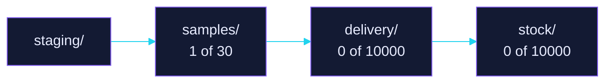

<p align="center"></p>

# Marcella: samples

<p align="center"><b>The samples lane: 1 of 30 Harbor task bundles.</b></p>

<p align="center"><a href="#summary"></a> <a href="#evidence-status"></a> <a href="#difficulty-tiers"></a></p>

<p align="center"><sub><a href="#abstract">Abstract</a> | <a href="#summary">Summary</a> | <a href="#difficulty-tiers">Difficulty tiers</a> | <a href="#evidence-status">Evidence status</a> | <a href="#coverage">Coverage</a> | <a href="#dataset-structure">Dataset structure</a> | <a href="#verification-and-quality-assurance">Verification and quality assurance</a> | <a href="#reproduction">Reproduction</a> | <a href="#cite">Cite</a> | <a href="#license">License</a> | <a href="#contact">Contact</a></sub></p>

## Abstract

The curated lane of this corpus: at most 30 Harbor task bundles, every anchor seated first and every other bundle in seal order. Bundles past that ceiling live in `delivery/`.

Each bundle is one complete Harbor task in a directory at the repository root, named by its uuid. A value a bundle does not carry reads `absent`, and this page never fills one in.

## Summary

| Property | Value |
| --- | --- |
| Bundles | 1 of 30 |
| Sealed | 1 of 1 |
| Registrations | none |
| Audit verdicts | 1 (HOLD) |
| Harbor schema | 1.4 |

| Bundle | Task | Field | Rollouts |
| --- | --- | --- | --- |
| [`77921209-6d15-4181-8f50-1506ccadbe48`](77921209-6d15-4181-8f50-1506ccadbe48/) | `ethara/aml-mrd-laip-tracking` 1.0.0 | life-sciences / medicine / haematology | 1 (Codex `gpt-6.1-sol`) |

`ethara/aml-mrd-laip-tracking` measures flow-cytometric measurable residual disease (MRD) in real acute myeloid leukaemia follow-up bone marrow by tracking each case's diagnosis leukaemia-associated immunophenotypes (LAIPs). It reports the ELN 2021 calls and the counted events as masks.

## Difficulty tiers

Difficulty is measured by the signed pilot alone and never declared in a bundle, so this page states no tier a bundle claims.

## Evidence status

The verdict is the audit outcome recorded at the sealed digest, and `none` means no verdict has landed for that digest yet. Only an authoring run removes a bundle from this lane, so removal waits for the next one.

| Bundle | Seal | Verdict |
| --- | --- | --- |
| `77921209-6d15-4181-8f50-1506ccadbe48` | `f24cb9ab1a14` | [HOLD](VERDICT.md) |

The CRUCIBLE audit found the rollout `mrd-aml__CJdAopy` a valid reasoning failure with no reward hacking. It retained four findings, none of which caps the bundle, and asks for the fixes to land under a new uuid that supersedes this one.

## Coverage

One resident bundle declares six keywords: `flow-cytometry`, `measurable-residual-disease`, `acute-myeloid-leukaemia`, `immunophenotyping`, `fcs` and `rare-event-detection`.

## Dataset structure

One bundle is resident, at the repository root. Its 160 FCS files (about 6 GB) are stored with Git LFS through the root `.gitattributes`.

```text
.
├── .gitattributes                         *.fcs tracked with Git LFS
├── 77921209-6d15-4181-8f50-1506ccadbe48/
│   ├── task.toml                          runner manifest
│   ├── instruction.md                     objective
│   ├── environment/                       sandbox image and data/ (315 files)
│   ├── solution/                          solve.sh, oracle.py, TRUTH.md
│   ├── tests/                             verifier and grading key
│   └── trajectories/gpt-6.1-sol/run_1/    recorded rollout
├── images/
├── README.md
└── VERDICT.md                             audit report at the sealed digest
```



## Verification and quality assurance

Each bundle carries its own verifier in `tests/`. `test.sh` grades with Harbor Reward Kit in a separate verifier container, behind an integrity gate that checks `/data` against the shipped digests of all 315 data files. The audit outcome at the sealed digest is in the root `VERDICT.md`.

## Reproduction

Each bundle directory is a complete Harbor task: `task.toml` is the runner manifest, `instruction.md` the objective, `environment/` the sandbox image and its data, `tests/` the verifier, and `solution/` the reference solution (`solve.sh` runs `oracle.py`). `trajectories/` holds the recorded agent rollouts.

Install Git LFS before cloning, or run `git lfs pull` afterwards, so the FCS files arrive as data rather than pointers. Then point a Harbor runner at one bundle directory to reproduce it.

## Cite

```bibtex
@misc{marcella2026,
  title        = {Marcella: Terminal-Bench Science 0.1 as a Hardened Reinforcement-Learning Evaluation Environment},
  author       = {Ethara.AI},
  year         = {2026},
  note         = {Wraps Terminal-Bench Science 0.1 (Harbor dataset terminal-bench-science/terminal-bench-science, 70 tasks, Apache-2.0). Harness pinned at commit 6e60de2f32727c095aac498f17c1863ef4b58181. Disposition: STALE, zero signed pilots.}
}
```

## License

Code is released under the [MIT License](LICENSE). Environment specifications are released under CC-BY-4.0. The wrapped benchmark (Terminal-Bench Science 0.1) retains its original Apache-2.0 license.

*Copyright 2026 Ethara.AI*

## Contact

[Ethara AI on GitHub](https://github.com/Ethara-Ai), [SECURITY.md](SECURITY.md) for a private report, and [CONTRIBUTING.md](CONTRIBUTING.md) for the contribution route.

Security disclosures: security@ethara.ai

Code of conduct matters: conduct@ethara.ai

---

## Copyright

Copyright (c) 2026 Green Rider Technology LLP (Ethara AI). All rights reserved.
